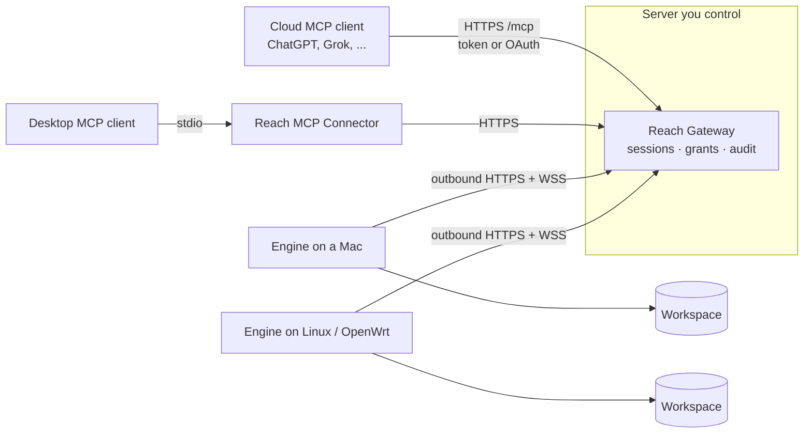

# Reach

English | [简体中文](README_cn.md)

**A self-hosted remote MCP gateway that lets cloud AI agents safely reach files and scripts on your own devices.** Devices connect outbound only, every session is a renewable lease, every mutation needs a scoped grant, and every call can be audited.

[](https://github.com/zpershuai/reach/actions/workflows/verify.yml)
[](LICENSE)

## Why Reach

AI agents increasingly run in the cloud (ChatGPT, Grok, hosted agent platforms), while the files they need stay on laptops, home servers and routers behind NAT. The usual workaround is a tunnel in front of a filesystem MCP server. That makes the files reachable, but it also exposes an open port. Every caller gets the same unrestricted access, and nobody can tell later who wrote what.

Reach puts a small Gateway on a server you control and a Rust Engine on each device:

- **Outbound only.** The Engine polls the Gateway over HTTPS and opens a WebSocket only when an agent asks for it. No inbound ports, no port forwarding.
- **Leases, not open sockets.** An agent opens a session, renews it, and closes it. The Engine enforces its own lease, idle and rotation limits as a fail-safe.
- **Grants for every mutation.** Writes and script runs carry a short-lived grant scoped to a workspace, path and method. Reads never gain write authority just by sharing a session.
- **Hardened file access.** Unix file access never follows symbolic links and uses descriptor-relative operations. Reads, directory scans, responses and writes have strict size and depth limits. Writes are atomic and keep permission bits.
- **Many devices, one endpoint.** One Gateway routes to many Engines (macOS, Linux, OpenWrt), each with its own credentials, session and grants.
- **Operable.** An optional web console provides owner login, device enrollment, live topology, a metadata-only activity audit and OAuth app management.

## Architecture



| Component | Language | Runs on | Role |
| --- | --- | --- | --- |
| Gateway | TypeScript (Node 24) | A server or VPS (Docker) | Authentication, session leases, grants, RPC forwarding, `/mcp`, console |
| Engine | Rust | Each device | Executes `fs.*` and opt-in `process.*` inside configured workspaces |
| MCP Connector | TypeScript | Desktop next to the MCP client | Translates stdio MCP into Gateway calls |

MCP tools: `list_devices`, `device_status`, `list_workspaces`, `fs_read`, `fs_list`, `fs_stat`, `fs_glob`, `fs_grep`, `fs_write`, `fs_edit`, `session_close`, `get_versions`, and (when enabled per workspace) `process_run`, `process_status`, `process_logs`, `process_stop`, `process_list`.

## Quick start

### A. Try it locally (about 5 minutes)

Requires Node 24 and stable Rust.

```bash
git clone https://github.com/zpershuai/reach.git && cd reach
npm --prefix packages/reach-rpc ci --ignore-scripts

# Terminal 1: Gateway on 127.0.0.1:8787
npm --prefix packages/reach-rpc run gateway

# Terminal 2: Engine serving ~/.reach/workspace
cargo run -p reach-rpc --bin engine -- http://127.0.0.1:8787
```

Then open a session, read a file and close it:

```bash
curl -sS -X POST http://127.0.0.1:8787/session/open -H 'content-type: application/json' --data '{}'
curl -sS http://127.0.0.1:8787/session/status          # wait for "status":"ready"
curl -sS -X POST http://127.0.0.1:8787/session/rpc -H 'content-type: application/json' \
  --data '{"requestId":"r1","method":"fs.list","params":{"workspace":"default","path":"."}}'
curl -sS -X POST http://127.0.0.1:8787/session/close -H 'content-type: application/json' --data '{}'
```

For writes with grants, renewal and the full control API, see the [protocol reference](docs/reference/protocol.md).

### B. Deploy for real

1. **Generate credentials and config.** Follow [configuration](docs/deploy/configuration.md) to create a Gateway env file and an Engine env file with separate random tokens.
2. **Run the Gateway.** Download `gateway-amd64.tgz` from the latest `gateway-v*` [Release](https://github.com/zpershuai/reach/releases), add your `gateway.env`, start it with `docker compose -f deploy/compose.yaml up -d --build`, and put HTTPS in front of it (Caddy example included). A versioned image is also published as `ghcr.io/<owner>/reach-gateway`. See [Gateway deployment](docs/deploy/gateway.md).
3. **Install an Engine on each device.** On macOS (arm64/x64) or Linux x86_64 with systemd, from a checkout of this repository:

   ```bash
   bash scripts/install-engine.sh /path/to/engine.env
   ```

   The script downloads the latest `engine-v*` Release binary for your platform, verifies it against the Release `SHA256SUMS` and its `--version`, then installs a LaunchAgent or systemd service. Pin a version with `REACH_ENGINE_VERSION=0.2.2`. OpenWrt and source builds are covered in [Engine](docs/deploy/engine.md), [Linux](docs/deploy/linux.md) and [OpenWrt](docs/deploy/openwrt.md).
4. **Connect an MCP client.** Point a remote client at `https://<your-gateway>/mcp` with the Controller token, or use OAuth for clients that cannot send static headers. Desktop clients can use the stdio Connector instead. See [MCP installation](docs/deploy/mcp.md).

| Client | How it connects | Status |
| --- | --- | --- |
| Grok Bot | Remote HTTP plugin ([template](grok-bot-plugin/README.md)) | Verified by the maintainer |
| ChatGPT connectors | Remote HTTP with OAuth (dynamic registration, PKCE) | Documented in [MCP installation](docs/deploy/mcp.md) |
| Other Streamable HTTP MCP clients | `/mcp` with a Bearer token or OAuth | Follows the MCP spec; verify in your host |
| Desktop stdio MCP clients | Local Connector process | Supported |

Finish with the [deployment checklist](docs/deploy/deployment-checklist.md).

## Security model

Reach assumes the Gateway operator is trusted and the network is not. Engines accept exactly one configured Gateway origin, and they use plaintext HTTP only on loopback. Tokens are compared in constant time, and OAuth tokens are stored only as digests. Process execution is disabled unless a workspace is explicitly allowlisted.

Know the current limits before exposing it. **A Controller token, or an approved OAuth app, can read and write every workspace on every registered Engine.** Treat it like an SSH key. Read [SECURITY.md](SECURITY.md) for the threat model, known limitations and how to report a vulnerability.

## How it compares

| | Tunnel + filesystem MCP server | Reach |
| --- | --- | --- |
| Inbound port on the device | Usually (or a tunnel agent) | None, outbound only |
| Per-call write authorization | No | Grant scoped to workspace, path and method |
| Session lifetime limits | Connection lifetime | Renewable lease, idle and rotation limits |
| Multiple devices | One server per device | One Gateway, many Engines |
| Audit trail | Tunnel logs only | Metadata audit in the console |
| Setup effort | Minutes | A server, a domain and an install per device |

If you only need occasional access to one machine on a trusted network, a tunnel is simpler. Reach is for long-lived access by cloud agents, where you want to bound and inspect what they do.

## Documentation

| Topic | Link |
| --- | --- |
| Deployment guide (Chinese) | [docs/deploy/README.md](docs/deploy/README.md) |
| Configuration and credentials | [docs/deploy/configuration.md](docs/deploy/configuration.md) |
| MCP clients | [docs/deploy/mcp.md](docs/deploy/mcp.md) |
| Gateway console | [docs/deploy/console.md](docs/deploy/console.md) |
| Script execution | [docs/deploy/processes.md](docs/deploy/processes.md) |
| Versions and upgrades | [docs/deploy/versions.md](docs/deploy/versions.md) |
| Protocol and runtime reference | [docs/reference/protocol.md](docs/reference/protocol.md) |
| Specifications | [openspec/specs/](openspec/specs/) |

Most deployment documents are currently in Chinese. Translations are welcome.

## Roadmap

- Controller tokens scoped to specific Engines or workspaces, and read-only tokens
- More than one interactive session per Engine
- Prebuilt Engine binaries for Linux arm64 and OpenWrt targets
- English versions of the deployment guides

## Contributing

See [CONTRIBUTING.md](CONTRIBUTING.md). Run `bash scripts/verify.sh` before sending a pull request.

## License

Copyright 2026 tent zp. Licensed under the [Apache License 2.0](LICENSE).
