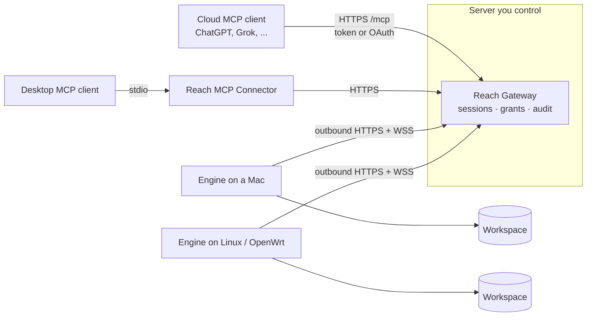

# Reach

English | [简体中文](README_cn.md)

**A self-hosted remote MCP gateway that lets cloud AI agents safely reach files and scripts on your own devices.** Devices connect outbound only, every session is a renewable lease, every mutation needs a scoped grant, and every call can be audited.

[](https://github.com/zpershuai/reach/actions/workflows/verify.yml)
[](LICENSE)

## Why Reach

AI agents increasingly run in the cloud (ChatGPT, Grok, hosted agent platforms), while the files they need stay on laptops, home servers and routers behind NAT. The usual workaround is a tunnel in front of a filesystem MCP server. That makes the files reachable, but it also exposes an open port. Every caller gets the same unrestricted access, and nobody can tell later who wrote what.

Reach puts a small Gateway on a server you control and a Rust Engine on each device:

- **Outbound only.** The Engine polls the Gateway over HTTPS and opens a WebSocket only when an agent asks for it. No inbound ports, no port forwarding.
- **Leases, not open sockets.** An agent opens a session, renews it, and closes it. The Engine enforces its own lease, idle and rotation limits as a fail-safe.
- **Grants for every mutation.** Writes and script runs carry a short-lived grant scoped to a workspace, path and method. Reads never gain write authority just by sharing a session.
- **Hardened file access.** Unix file access never follows symbolic links and uses descriptor-relative operations. Reads, directory scans, responses and writes have strict size and depth limits. Writes are atomic and keep permission bits.
- **Many devices, one endpoint.** One Gateway routes to many Engines (macOS, Linux, OpenWrt), each with its own credentials, session and grants.
- **Scoped clients.** Each delegated or OAuth client identity gets explicit Engine, workspace and read/write/execute permissions, an expiry, and can be rotated or revoked without touching other clients.
- **Operable.** An optional web console provides owner login, device enrollment, client permissions, live topology, a metadata-only activity audit and OAuth app management.

Engine 0.3.0 also supports a local workspace JSON file with hot reload. See [dynamic workspaces](docs/deploy/engine.md) for the format, reload behavior and Gateway-first upgrade order.

## Architecture



| Component | Language | Runs on | Role |
| --- | --- | --- | --- |
| Gateway | TypeScript (Node 24) | A server or VPS (Docker) | Authentication, session leases, grants, RPC forwarding, `/mcp`, console |
| Engine | Rust | Each device | Executes `fs.*` and opt-in `process.*` inside configured workspaces |
| MCP Connector | TypeScript | Desktop next to the MCP client | Translates stdio MCP into Gateway calls |

MCP tools: `list_devices`, `device_status`, `list_workspaces`, `fs_read`, `fs_list`, `fs_stat`, `fs_glob`, `fs_grep`, `fs_write`, `fs_edit`, `session_close`, `get_versions`, and (when enabled per workspace) `process_run`, `process_status`, `process_logs`, `process_stop`, `process_list`.

## Supported platforms and prerequisites

| Component | Prebuilt Release assets | Build from source |
| --- | --- | --- |
| Engine | macOS arm64 and x64; Linux x86_64 (static musl, systemd or x86_64 OpenWrt) | Same targets; other Unix targets are untested |
| Gateway | Linux amd64 tarball for Docker Compose | Any host with Node.js 24 |
| MCP Connector | None; build from source | Node.js 24 next to the MCP client |

Building needs Git, Node.js 24 with npm, a Rust toolchain and Python 3. CI verifies the exact versions pinned in [`scripts/toolchain.json`](scripts/toolchain.json); other versions are not tested. Script execution is Unix-only. Deploying a remote Gateway also needs Docker with Compose, a domain and an HTTPS reverse proxy.

## Quick start

### A. Try it locally

This is a trusted loopback trial: without credentials the Gateway accepts any local caller and gives no client isolation. It refuses to listen on a non-loopback address without authentication.

```bash
git clone https://github.com/zpershuai/reach.git && cd reach
npm --prefix packages/reach-rpc ci --ignore-scripts

# Terminal 1: Gateway on 127.0.0.1:8787, polling the Engine every 5 seconds (default 120)
REACH_HEARTBEAT_INTERVAL_SECS=5 npm --prefix packages/reach-rpc run gateway

# Terminal 2: Engine serving ~/.reach/workspace as workspace "default"
cargo run -p reach-rpc --bin engine -- http://127.0.0.1:8787
```

Then open a session, list the workspace, write a file with a grant, and close the session:

```bash
curl -sS -X POST http://127.0.0.1:8787/session/open -H 'content-type: application/json' --data '{}'
curl -sS http://127.0.0.1:8787/session/status          # repeat until "status":"ready"
curl -sS -X POST http://127.0.0.1:8787/session/rpc -H 'content-type: application/json' \
  --data '{"requestId":"r1","method":"fs.list","params":{"workspace":"default","path":"."}}'
curl -sS -X POST http://127.0.0.1:8787/grants -H 'content-type: application/json' \
  --data '{"workspace":"default","path":"hello.txt","methods":["fs.write"]}'   # returns a grantId
curl -sS -X POST http://127.0.0.1:8787/session/rpc -H 'content-type: application/json' \
  --data '{"requestId":"w1","method":"fs.write","params":{"workspace":"default","path":"hello.txt","content":"hi","mode":"overwrite"},"permission":{"grantId":"<grantId>"}}'
curl -sS -X POST http://127.0.0.1:8787/session/close -H 'content-type: application/json' --data '{}'
```

A write without a matching grant returns `PERMISSION_DENIED`. Stop both processes with Ctrl-C; `~/.reach/workspace` keeps your files. Renewal and the full control API are in the [protocol reference](docs/reference/protocol.md).

[First run](docs/deploy/first-run.md) continues on the same machine with authentication: the console, a scoped MCP client, an explicitly enabled script, revocation and uninstall.

### B. Deploy for real

1. **Generate credentials and config.** Follow [configuration](docs/deploy/configuration.md) to create a Gateway env file and an Engine env file with separate random tokens.
2. **Run the Gateway.** Download `gateway-amd64.tgz` from the latest `gateway-v*` [Release](https://github.com/zpershuai/reach/releases), add your `gateway.env`, start it with `docker compose -f deploy/compose.yaml up -d --build`, and put HTTPS in front of it (Caddy example included). New releases include local Docker build inputs; previously published GHCR images remain available. See [Gateway deployment](docs/deploy/gateway.md).
3. **Install an Engine on each device.** On macOS (arm64/x64) or Linux x86_64 with systemd, from a checkout of this repository:

   ```bash
   bash scripts/install-engine.sh /path/to/engine.env
   ```

   The script downloads the latest `engine-v*` Release binary for your platform, verifies it against the Release `SHA256SUMS` and its `--version`, then installs a LaunchAgent or systemd service. Pin a version with `REACH_ENGINE_VERSION=0.3.2`. OpenWrt and source builds are covered in [Engine](docs/deploy/engine.md), [Linux](docs/deploy/linux.md) and [OpenWrt](docs/deploy/openwrt.md).
4. **Create a scoped client and connect MCP.** In the console, create a delegated client with only the Engines, workspaces and read/write/execute permissions it needs ([client access](docs/deploy/client-access.md)). Point a remote client at `https://<your-gateway>/mcp` with that token, or approve an OAuth client with an explicit selection for hosts that cannot send static headers. Desktop clients can use the stdio Connector instead. Keep the Owner Controller token for administration. See [MCP installation](docs/deploy/mcp.md).

| Client | How it connects | Status |
| --- | --- | --- |
| Grok Bot | Remote HTTP plugin ([template](grok-bot-plugin/README.md)) | Verified by the maintainer |
| ChatGPT connectors | Remote HTTP with OAuth (dynamic registration, PKCE) | Documented in [MCP installation](docs/deploy/mcp.md) |
| Other Streamable HTTP MCP clients | `/mcp` with a Bearer token or OAuth | Follows the MCP spec; verify in your host |
| Desktop stdio MCP clients | Local Connector process | Supported |

Finish with the [deployment checklist](docs/deploy/deployment-checklist.md). Upgrade the Gateway before Engines; see [versions](docs/deploy/versions.md) for compatibility.

### Uninstall

Stop each Engine service, the Gateway container and MCP client entries as described in [operations](docs/deploy/operations.md#停用组件). Uninstalling never deletes workspaces; remove program files and private configuration deliberately after backing up anything you want to keep. [First run](docs/deploy/first-run.md#10-uninstall) shows the same order for a source checkout.

## Security model

Reach assumes the Gateway operator is trusted and the network is not. Engines accept exactly one configured Gateway origin, and they use plaintext HTTP only on loopback. Tokens are compared in constant time, and OAuth tokens are stored only as digests. Process execution is disabled unless a workspace is explicitly allowlisted.

Know the current limits before exposing it:

- **The Owner Controller token, and any legacy OAuth app you have not restricted, can read and write every workspace on every registered Engine.** Treat it like an SSH key and give daily clients scoped identities instead.
- The Gateway is trusted: it relays and can see file content and script output. There is no end-to-end encryption past it.
- Enabled scripts run with the Engine account's OS privileges. A workspace is not a sandbox.
- One interactive session per Engine; sessions and grants live in memory and do not survive a Gateway restart.
- Releases are checked with SHA-256 over HTTPS from the release repository. They are not signed and have no SBOM or provenance attestation yet.

Read [SECURITY.md](SECURITY.md) for the threat model, known limitations and how to report a vulnerability.

## How it compares

| | Tunnel + filesystem MCP server | Reach |
| --- | --- | --- |
| Inbound port on the device | Usually (or a tunnel agent) | None, outbound only |
| Per-call write authorization | No | Grant scoped to workspace, path and method |
| Session lifetime limits | Connection lifetime | Renewable lease, idle and rotation limits |
| Multiple devices | One server per device | One Gateway, many Engines |
| Audit trail | Tunnel logs only | Metadata audit in the console |
| Setup effort | One tunnel per device | A server, a domain and an install per device |

If you only need occasional access to one machine on a trusted network, a tunnel is simpler. Reach is for long-lived access by cloud agents, where you want to bound and inspect what they do.

## Documentation

| Topic | Link |
| --- | --- |
| First run on one machine | [docs/deploy/first-run.md](docs/deploy/first-run.md) |
| Deployment guide (Chinese) | [docs/deploy/README.md](docs/deploy/README.md) |
| Configuration and credentials | [docs/deploy/configuration.md](docs/deploy/configuration.md) |
| Client identities and permissions | [docs/deploy/client-access.md](docs/deploy/client-access.md) |
| MCP clients | [docs/deploy/mcp.md](docs/deploy/mcp.md) |
| Gateway console | [docs/deploy/console.md](docs/deploy/console.md) |
| Script execution | [docs/deploy/processes.md](docs/deploy/processes.md) |
| Versions, compatibility and upgrades | [docs/deploy/versions.md](docs/deploy/versions.md) |
| Troubleshooting | [docs/deploy/troubleshooting.md](docs/deploy/troubleshooting.md) |
| Protocol and runtime reference | [docs/reference/protocol.md](docs/reference/protocol.md) |
| Specifications | [openspec/specs/](openspec/specs/) |

Most deployment documents are currently in Chinese. Translations are welcome.

## Roadmap

- More than one interactive session per Engine
- Prebuilt Engine binaries for Linux arm64 and OpenWrt targets
- English versions of the deployment guides

Longer-term items that need evidence first (performance baselines, signed releases, SBOM and provenance) are tracked in the [roadmap](docs/dev/roadmap.md).

## Contributing

See [CONTRIBUTING.md](CONTRIBUTING.md). Run `bash scripts/verify.sh` before sending a pull request.

## License

Copyright 2026 tent zp. Licensed under the [Apache License 2.0](LICENSE).
