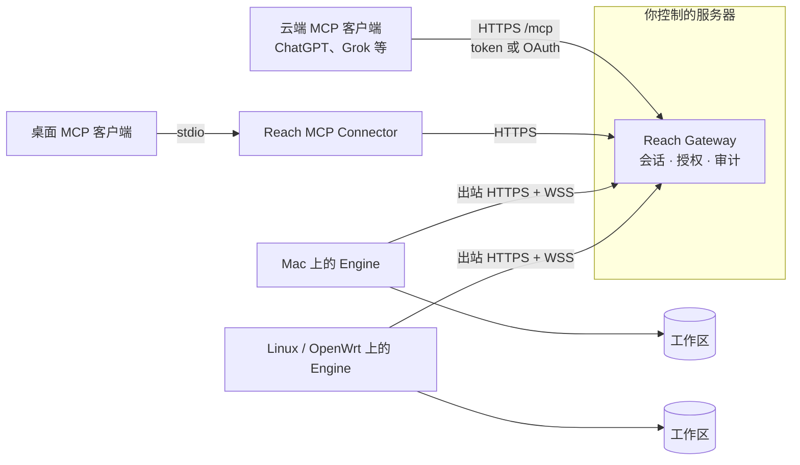

# Reach

[English](README.md) | 简体中文

**自托管的远程 MCP 网关，让云端 AI Agent 安全地访问你自己设备上的文件和脚本。** 设备只发起出站连接；每个会话都是可续约的租约；每次修改都需要限定范围的授权（grant）；所有调用都可以审计。

[](https://github.com/zpershuai/reach/actions/workflows/verify.yml)
[](LICENSE)

## 为什么需要 Reach

AI Agent 越来越多地运行在云端（ChatGPT、Grok、各类托管 Agent 平台），而它们需要的文件还在 NAT 后面的笔记本、家用服务器和路由器上。常见做法是在 filesystem MCP 服务前面加一条隧道。这样文件确实能访问到，但设备多了一个暴露的入口，所有调用方拥有同样的无限制权限，事后也无法追查是谁写了什么。

Reach 在你自己控制的服务器上运行一个轻量的 Gateway，在每台设备上运行一个 Rust Engine：

- **只出站。** Engine 通过 HTTPS 轮询 Gateway，只有 Agent 请求时才建立 WebSocket。不需要入站端口，也不需要端口转发。
- **用租约代替常开连接。** Agent 打开会话、按时续约、用完关闭。Engine 自己也会执行租约、空闲和轮换的上限，作为兜底。
- **每次修改都要 grant。** 写入和脚本执行都要带一个短时有效的 grant，它限定了工作区、路径和方法。读操作不会因为共用同一个会话就获得写权限。
- **加固的文件访问。** Unix 上的文件访问不跟随符号链接，并且基于目录描述符做相对操作。读取、目录遍历、响应和写入都有严格的大小和深度上限。写入是原子的，并保留文件权限位。
- **多设备，一个入口。** 一个 Gateway 可以路由到多个 Engine（macOS、Linux、OpenWrt），每个 Engine 有独立的凭证、会话和 grant。
- **限定范围的客户端。** 每个 delegated 或 OAuth 客户端身份都有明确的 Engine、工作区和读/写/执行权限以及到期时间，可单独轮换或撤销，不影响其他客户端。
- **便于运维。** 可选的 Web 控制台提供管理员登录、设备注册、客户端权限、实时拓扑、只记录元数据的操作审计，以及 OAuth 应用管理。

Engine 0.3.0 支持通过本机 JSON 文件动态调整工作区，无需重启。文件格式、重载行为和 Gateway 优先升级顺序见 [Engine 部署](docs/deploy/engine.md)。

## 架构



| 组件 | 语言 | 运行位置 | 职责 |
| --- | --- | --- | --- |
| Gateway | TypeScript（Node 24） | 服务器或 VPS（Docker） | 认证、会话租约、grant、RPC 转发、`/mcp`、控制台 |
| Engine | Rust | 每台设备 | 在配置的工作区内执行 `fs.*`，以及显式启用的 `process.*` |
| MCP Connector | TypeScript | MCP 客户端所在的桌面机器 | 把 stdio MCP 调用转换成 Gateway 请求 |

MCP 工具：`list_devices`、`device_status`、`list_workspaces`、`fs_read`、`fs_list`、`fs_stat`、`fs_glob`、`fs_grep`、`fs_write`、`fs_edit`、`session_close`、`get_versions`。按工作区启用脚本执行后，还有 `process_run`、`process_status`、`process_logs`、`process_stop`、`process_list`。

## 支持平台与前置条件

| 组件 | 预构建 Release 资产 | 源码构建 |
| --- | --- | --- |
| Engine | macOS arm64 和 x64；Linux x86_64（静态 musl，systemd 或 x86_64 OpenWrt） | 同样的目标；其他 Unix 目标未经测试 |
| Gateway | 用于 Docker Compose 的 Linux amd64 tar 包 | 任何装有 Node.js 24 的主机 |
| MCP Connector | 无，需要源码构建 | MCP 客户端所在机器上的 Node.js 24 |

构建需要 Git、Node.js 24 与 npm、Rust 工具链和 Python 3。CI 使用 [`scripts/toolchain.json`](scripts/toolchain.json) 固定的确切版本验证，其他版本未经测试。脚本执行只支持 Unix。部署远程 Gateway 还需要 Docker 与 Compose、域名和 HTTPS 反向代理。

## 快速上手

### A. 本地体验

这是可信的本机回环体验：未配置凭证时 Gateway 接受任何本机调用方，不提供客户端隔离；未配置认证时它拒绝监听非回环地址。

```bash
git clone https://github.com/zpershuai/reach.git && cd reach
npm --prefix packages/reach-rpc ci --ignore-scripts

# 终端 1：Gateway，监听 127.0.0.1:8787，每 5 秒轮询 Engine（默认 120 秒）
REACH_HEARTBEAT_INTERVAL_SECS=5 npm --prefix packages/reach-rpc run gateway

# 终端 2：Engine，把 ~/.reach/workspace 作为工作区 "default"
cargo run -p reach-rpc --bin engine -- http://127.0.0.1:8787
```

然后打开会话、列出工作区、凭 grant 写入文件、关闭会话：

```bash
curl -sS -X POST http://127.0.0.1:8787/session/open -H 'content-type: application/json' --data '{}'
curl -sS http://127.0.0.1:8787/session/status          # 重复执行，直到 "status":"ready"
curl -sS -X POST http://127.0.0.1:8787/session/rpc -H 'content-type: application/json' \
  --data '{"requestId":"r1","method":"fs.list","params":{"workspace":"default","path":"."}}'
curl -sS -X POST http://127.0.0.1:8787/grants -H 'content-type: application/json' \
  --data '{"workspace":"default","path":"hello.txt","methods":["fs.write"]}'   # 返回 grantId
curl -sS -X POST http://127.0.0.1:8787/session/rpc -H 'content-type: application/json' \
  --data '{"requestId":"w1","method":"fs.write","params":{"workspace":"default","path":"hello.txt","content":"hi","mode":"overwrite"},"permission":{"grantId":"<grantId>"}}'
curl -sS -X POST http://127.0.0.1:8787/session/close -H 'content-type: application/json' --data '{}'
```

没有匹配 grant 的写入返回 `PERMISSION_DENIED`。用 Ctrl-C 停止两个进程，`~/.reach/workspace` 中的文件会保留。续约以及完整的控制 API 见[协议参考](docs/reference/protocol.md)（英文）。

[首次运行](docs/deploy/first-run.md)（英文）在同一台机器上继续，启用认证：控制台、限定范围的 MCP 客户端、显式启用的脚本、撤销和卸载。

### B. 正式部署

1. **生成凭证和配置。** 按[配置与凭证](docs/deploy/configuration.md)生成 Gateway 和 Engine 两份环境文件，使用两个互不相同的随机 token。
2. **运行 Gateway。** 从最新的 `gateway-v*` [Release](https://github.com/zpershuai/reach/releases) 下载 `gateway-amd64.tgz`，放入 `gateway.env`，执行 `docker compose -f deploy/compose.yaml up -d --build` 启动，并在前面配置 HTTPS（仓库附带 Caddy 示例）。每个版本也会发布镜像 `ghcr.io/<owner>/reach-gateway`。详见 [Gateway 部署](docs/deploy/gateway.md)。
3. **在每台设备上安装 Engine。** macOS（arm64/x64）或带 systemd 的 Linux x86_64，在本仓库目录下执行：

   ```bash
   bash scripts/install-engine.sh /path/to/engine.env
   ```

   脚本会下载适合当前平台的最新 `engine-v*` Release 二进制，用 Release 的 `SHA256SUMS` 和 `--version` 校验，然后安装为 LaunchAgent 或 systemd 服务。用 `REACH_ENGINE_VERSION=0.3.1` 可以固定版本。OpenWrt 和源码构建见 [Engine](docs/deploy/engine.md)、[Linux](docs/deploy/linux.md)、[OpenWrt](docs/deploy/openwrt.md)。
4. **创建限定范围的客户端并连接 MCP。** 在控制台创建 delegated 客户端，只授予它需要的 Engine、工作区和读/写/执行权限（见[客户端权限](docs/deploy/client-access.md)）。远程客户端用该 token 连接 `https://<你的 Gateway>/mcp`；不能设置静态请求头的宿主可以用 OAuth，并在批准时明确选择资源。桌面客户端也可以改用 stdio Connector。Owner Controller token 只用于管理。详见 [MCP 安装](docs/deploy/mcp.md)。

| 客户端 | 接入方式 | 状态 |
| --- | --- | --- |
| Grok Bot | 远程 HTTP 插件（[模板](grok-bot-plugin/README.md)） | 维护者已验证 |
| ChatGPT 连接器 | 远程 HTTP + OAuth（动态注册、PKCE） | 见 [MCP 安装](docs/deploy/mcp.md) |
| 其他 Streamable HTTP MCP 客户端 | `/mcp` + Bearer token 或 OAuth | 遵循 MCP 规范，请在自己的宿主中验证 |
| 桌面 stdio MCP 客户端 | 本地 Connector 进程 | 支持 |

部署完成后，按[部署检查清单](docs/deploy/deployment-checklist.md)验收。升级时先升级 Gateway，再升级 Engine；兼容关系见[版本](docs/deploy/versions.md)。

### 卸载

按[运维](docs/deploy/operations.md#停用组件)停止各 Engine 服务、Gateway 容器并移除 MCP 客户端条目。卸载不会删除工作区；备份需要保留的内容后，再有意识地删除程序文件和私有配置。源码运行方式的顺序见[首次运行](docs/deploy/first-run.md#10-uninstall)。

## 安全模型

Reach 的前提是 Gateway 的运营者可信，而网络不可信。每个 Engine 只接受一个配置好的 Gateway 地址，明文 HTTP 只允许用于本机回环地址。token 用常量时间比较，OAuth 令牌只保存摘要。脚本执行默认关闭，只有显式列入允许名单的工作区才能执行。

对外开放之前，请先了解当前的限制：

- **Owner Controller token，以及尚未收紧的存量 OAuth 应用，可以读写所有已注册 Engine 的全部工作区。** 请像对待 SSH 私钥一样保管它，日常客户端改用限定范围的身份。
- Gateway 是可信的：它转发并能看到文件内容和脚本输出，不提供越过 Gateway 的端到端加密。
- 启用的脚本以 Engine 账户的系统权限运行，工作区不是沙箱。
- 每个 Engine 同时只有一个交互会话；会话和 grant 保存在内存中，Gateway 重启后不保留。
- Release 通过 HTTPS 上的 SHA-256 校验，尚未签名，也没有 SBOM 或来源证明。

威胁模型、已知限制和漏洞报告方式见 [SECURITY.md](SECURITY.md)（英文）。

## 与常见方案对比

| | 隧道 + filesystem MCP 服务 | Reach |
| --- | --- | --- |
| 设备上的入站端口 | 通常需要（或运行隧道客户端） | 不需要，只出站 |
| 写操作逐次授权 | 无 | grant 限定工作区、路径和方法 |
| 会话生命周期上限 | 跟随连接 | 可续约租约，加上空闲和轮换上限 |
| 多设备 | 每台设备一个服务 | 一个 Gateway 管理多个 Engine |
| 审计记录 | 只有隧道日志 | 控制台记录元数据审计 |
| 部署成本 | 每台设备一条隧道 | 需要一台服务器、一个域名，并在每台设备上安装 |

如果只是偶尔在可信网络里访问一台机器，用隧道更简单。Reach 适合云端 Agent 长期访问、而且需要限定和审查它们行为的场景。

## 文档

| 主题 | 链接 |
| --- | --- |
| 单机首次运行（英文） | [docs/deploy/first-run.md](docs/deploy/first-run.md) |
| 部署总览 | [docs/deploy/README.md](docs/deploy/README.md) |
| 配置与凭证 | [docs/deploy/configuration.md](docs/deploy/configuration.md) |
| 客户端身份与权限 | [docs/deploy/client-access.md](docs/deploy/client-access.md) |
| MCP 客户端 | [docs/deploy/mcp.md](docs/deploy/mcp.md) |
| Gateway 控制台 | [docs/deploy/console.md](docs/deploy/console.md) |
| 脚本执行 | [docs/deploy/processes.md](docs/deploy/processes.md) |
| 版本、兼容与升级 | [docs/deploy/versions.md](docs/deploy/versions.md) |
| 故障排查 | [docs/deploy/troubleshooting.md](docs/deploy/troubleshooting.md) |
| 协议与运行时参考（英文） | [docs/reference/protocol.md](docs/reference/protocol.md) |
| 规格说明 | [openspec/specs/](openspec/specs/) |

## 路线图

- 每个 Engine 支持多个交互会话
- 提供 Linux arm64 和 OpenWrt 的预构建 Engine
- 部署文档的英文版

需要先积累证据的长期事项（性能基线、发布签名、SBOM 与来源证明）见[路线图](docs/dev/roadmap.md)（英文）。

## 参与贡献

见 [CONTRIBUTING.md](CONTRIBUTING.md)。提交 Pull Request 前请先运行 `bash scripts/verify.sh`。

## 许可证

Copyright 2026 tent zp。以 [Apache License 2.0](LICENSE) 授权。
