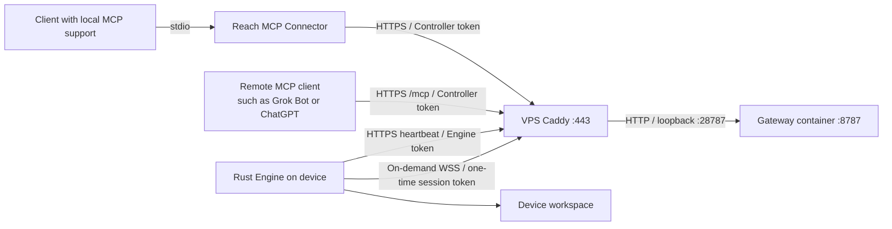

# Deploying Reach's three components

English | [简体中文](README_cn.md)

These guides describe the current Model B implementation: a Gateway on a VPS, an Engine on the device holding the files, a desktop MCP Connector started by its client, and remote MCP clients connecting to Gateway `/mcp`. They cover Docker Compose/Caddy, macOS LaunchAgent, Linux systemd and OpenWrt procd. Replace the reserved `example.com` domains, accounts and absolute paths with your own configuration.

## Reading order

| Guide | Contents |
| --- | --- |
| [First run on one machine](first-run.md) | Build from source; set up the console, scoped MCP access and scripts; revoke and uninstall |
| [Configuration and credentials](configuration.md) | Private configuration, domains, authentication and signing boundaries |
| [Gateway deployment](gateway.md) | Build, upload, Compose, Caddy and HTTPS checks |
| [Gateway console](console.md) | Owner setup, enrollment, audit, proxy rate limits, backup and recovery |
| [Engine deployment](engine.md) | Mac builds, workspaces, background installation, start and stop |
| [Linux Engine](linux.md) | VPS/home server installation and system/user systemd services |
| [OpenWrt and multiple devices](openwrt.md) | Router installation, private Node libraries and multiple Engines |
| [Client permissions](client-access.md) | Scoped identities, policies, credential lifecycle, legacy review and rollback |
| [MCP installation](mcp.md) | Remote HTTP MCP, Grok Bot, ChatGPT OAuth and local stdio clients |
| [Deployment verification](verification.md) | Source checks, public RPC, installed MCP and recovery |
| [Operations and rollback](operations.md) | Updates, backups, credentials, logs, rollback and shutdown |
| [Script tasks](processes.md) | Process interfaces, execution permissions, lifecycle and logs |
| [Node runtime](node-runtime.md) | Runtime delivery, JS launchers and Rust execution boundaries |
| [Component versions](versions.md) | Releases, compatibility, upgrade order and installation records |
| [Troubleshooting](troubleshooting.md) | Networking, authentication, sessions, recovery, permissions and tool lists |
| [Deployment checklist](deployment-checklist.md) | Installation, acceptance, upgrades and private records |

## Where each component runs

| Component | Responsibility | Runs as | Stored data |
| --- | --- | --- | --- |
| Gateway | Authentication, session leases, grants, RPC forwarding and optional console | VPS Docker Compose | Sessions/grants in memory; optional SQLite for administration, enrollment and metadata audit |
| Engine | Workspace `fs.*` requests and explicitly enabled `process.*` tasks | LaunchAgent / systemd / procd | Files stay in device workspaces |
| MCP Connector | Converts MCP calls to Gateway requests | Local Node process launched by the MCP client | Private device configuration; no remote workspace files |

Start MCP installation at [mcp.md](mcp.md). The desktop client launches the stdio Connector; HTTP MCP runs inside the Gateway using the existing domain, port and VPS container. Stdio uses a device configuration file; HTTP exposes Engines registered with the Gateway.

## Initial deployment order

1. Choose the domain, Engine identifiers and workspaces; generate two independent credentials using [configuration.md](configuration.md).
2. Build Gateway TypeScript outputs, upload to the VPS, start Compose and connect Caddy.
3. Build the Rust Engine for each target platform, install its background service and check heartbeats.
4. Install a desktop stdio Connector or configure remote HTTPS `/mcp`; Grok Bot has a plugin template and ChatGPT supports OAuth.
5. Run public and MCP verification when no other sessions are active. Use fault injection separately when validating recovery.

Reuse existing private configuration for upgrades; see [Operations and rollback](operations.md). Commands run from the repository root unless marked for the VPS. Keep real hosts, accounts, addresses, deployment records and backup locations in ignored `.reach/` files or outside the repository.

## Deployment boundaries

- One Gateway can register multiple Engines with separate sessions, grants and RPC routing. Each Engine keeps one interactive session; see [multiple devices](openwrt.md).
- Engines initiate outbound connections. Macs need no public inbound ports or port forwarding.
- LaunchAgent runs after user login. Sleeping, logged-out or disconnected devices are unavailable.
- Gateway restarts lose in-memory sessions and grants. Workspace files remain; clients must reopen sessions.
- Timed-out writes may have committed. File RPC is never automatically replayed; read the content or revision after recovery.
- There is no unified `reach install` deployment CLI or published npm package. On macOS and Linux x86_64, `scripts/install-engine.sh` installs a Release Engine verified with SHA-256. Other steps use the existing scripts and source builds.

Sources: [Gateway entry](../../packages/reach-rpc/src/gateway-main.ts), [Gateway implementation](../../packages/reach-rpc/src/gateway.ts), [Engine configuration](../../crates/reach-rpc/src/runtime/config.rs), [MCP configuration](../../packages/grok-bot-mcp-connector/src/config.ts).
