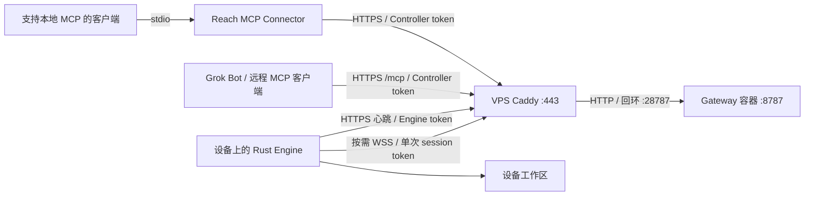

# Reach 三组件部署文档

本套文档对应当前仓库的 Model B 实现：Gateway 部署在 VPS，Engine 运行在文件所在设备，桌面 MCP Connector 由客户端启动，远程 MCP 客户端连接 Gateway `/mcp`。下文提供 Docker Compose/Caddy、macOS LaunchAgent、Linux systemd 与 OpenWrt procd 的通用安装流程。示例域名使用 `example.com`，账号与绝对路径均须替换为自己的配置。

## 阅读顺序

| 文档 | 内容 |
| --- | --- |
| [配置与凭证](configuration.md) | 部署参数、生成私有配置、域名、认证与签名的版本边界 |
| [Gateway 部署](gateway.md) | 构建、上传、Compose、Caddy、HTTPS 检查 |
| [Gateway 控制台](console.md) | Owner 设置、设备注册、审计、代理限流与数据备份恢复 |
| [Engine 部署](engine.md) | Mac 构建、工作区、后台安装、启动与停止 |
| [Linux Engine](linux.md) | VPS 和家庭 server 安装、systemd 系统与用户服务 |
| [OpenWrt 与多设备](openwrt.md) | 路由器安装、私有 Node 库、一个 Gateway 管理多个 Engine |
| [MCP 安装](mcp.md) | Grok Bot 远程 HTTP 插件、通用 stdio 安装、客户端配置 |
| [部署验证](verification.md) | 源码检查、公网 RPC、安装后的 MCP、故障恢复验证 |
| [运维与回滚](operations.md) | 升级、备份、凭证轮换、日志、回滚与停用 |
| [脚本任务](processes.md) | process 接口、执行权限、任务生命周期及日志 |
| [Node runtime](node-runtime.md) | 安装交付策略、JS 启动入口与 Rust Engine 的执行边界 |
| [组件版本](versions.md) | 独立发布号、版本查询、安装记录与更新方式 |
| [故障排查](troubleshooting.md) | 网络、认证、会话、文件权限和工具列表问题 |
| [部署检查清单](deployment-checklist.md) | 安装、验收、升级与私有记录保管 |

## 三个组件分别运行在哪里

| 组件 | 职责 | 常驻方式 | 保存的数据 |
| --- | --- | --- | --- |
| Gateway | 认证、会话租约、grant、转发 RPC 与可选管理控制台 | VPS Docker Compose | 会话和 grant 在内存；可选 SQLite 保存管理、注册和元数据审计 |
| Engine | 执行工作区内的 `fs.*` 请求及显式启用的 `process.*` 任务 | LaunchAgent / systemd / procd | 文件保存在设备工作区 |
| MCP Connector | 将 MCP 工具调用转换为 Gateway 请求 | MCP 客户端启动本地 Node 进程 | 私有设备配置；不存放远程工作区文件 |

MCP 安装入口为 [mcp.md](mcp.md)。桌面 stdio Connector 由客户端启动；远程 HTTP MCP 在 Gateway 内运行，复用现有域名、监听端口与 VPS 容器。设备文件由 stdio 客户端配置；HTTP 直接展示 Gateway 注册的 Engine。

## 首次部署顺序

1. 确定域名、Engine 标识和工作区，按 [configuration.md](configuration.md) 生成两份独立凭证与配置。
2. 构建 Gateway 的 TypeScript 产物，上传 VPS，启动 Compose，再接入 Caddy。
3. 为目标设备构建 Rust Engine，按操作系统安装后台服务并检查心跳。
4. 桌面客户端安装 stdio Connector；远程客户端配置 HTTPS `/mcp` 或安装 Grok Bot 插件。
5. 在没有其他活动会话时执行公网与 MCP 验证；需要验收恢复能力时再执行故障注入。

已有部署沿用自己的私有配置；升级步骤见 [运维与回滚](operations.md)。所有命令默认从仓库根目录执行，标注“VPS”的命令在服务器执行。真实主机、账号、地址、部署记录与备份位置只保存在 Git 忽略的 `.reach/` 或仓库外，不写入公开文档。

## 部署边界

- 一个 Gateway 可注册多个 Engine，按设备隔离会话、授权和 RPC；每个 Engine 同时保留一条交互会话，配置方式见 [多设备部署](openwrt.md)。
- Engine 只发起出站连接，无需给 Mac 开放公网入站端口或配置端口转发。
- LaunchAgent 在用户登录后运行；设备休眠、退出登录或断网期间不可用。
- Gateway 重启会丢失内存会话与 grant。文件保留在 Engine 工作区，客户端需要重新打开会话。
- 写入超时可能已经提交。客户端不会自动重放文件 RPC，恢复后先读取内容或 revision 确认结果。
- 仓库没有统一的 `reach install` 部署 CLI，也没有已发布的 npm 安装包；本文使用现有脚本和源码构建产物。

源码依据：[Gateway 入口](../../packages/reach-rpc/src/gateway-main.ts)、[Gateway 实现](../../packages/reach-rpc/src/gateway.ts)、[Engine 配置](../../crates/reach-rpc/src/runtime/config.rs)、[MCP 配置](../../packages/grok-bot-mcp-connector/src/config.ts)。
