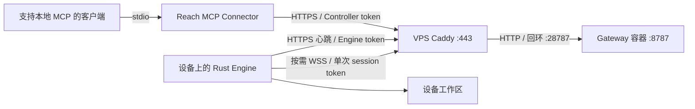

# Reach 三组件部署文档

本套文档对应当前仓库的 Model B 实现：Gateway 部署在 VPS，Engine 运行在文件所在设备，MCP Connector 由 MCP 客户端启动。推荐沿用现有 VPS 的 Docker Compose 与 Caddy，并在 Mac 上使用 LaunchAgent 托管 Engine。

## 阅读顺序

| 文档 | 内容 |
| --- | --- |
| [配置与凭证](configuration.md) | 部署参数、生成私有配置、域名、认证与签名的版本边界 |
| [Gateway 部署](gateway.md) | 构建、上传、Compose、Caddy、HTTPS 检查 |
| [Engine 部署](engine.md) | Mac 构建、工作区、后台安装、启动与停止 |
| [MCP 安装](mcp.md) | 通用 stdio MCP 安装、客户端配置、动态与静态工具 |
| [部署验证](verification.md) | 源码检查、公网 RPC、安装后的 MCP、故障恢复验证 |
| [运维与回滚](operations.md) | 升级、备份、凭证轮换、日志、回滚与停用 |
| [组件版本](versions.md) | 独立发布号、版本查询、安装记录与更新方式 |
| [故障排查](troubleshooting.md) | 网络、认证、会话、文件权限和工具列表问题 |
| [当前部署记录](current-deployment.md) | 实际路径、域名、旧部署、2026-10-05 的验收记录 |

## 三个组件分别运行在哪里

| 组件 | 职责 | 常驻方式 | 保存的数据 |
| --- | --- | --- | --- |
| Gateway | 认证、会话租约、写入 grant、转发 RPC | VPS Docker Compose | 会话和 grant 在内存，无文件业务数据库 |
| Engine | 执行工作区内的 `fs.*` 请求 | Mac LaunchAgent | 文件保存在设备工作区 |
| MCP Connector | 将 MCP 工具调用转换为 Gateway 请求 | MCP 客户端启动本地 Node 进程 | 私有设备配置；不存放远程工作区文件 |

MCP 是一个通用 stdio 服务，安装入口为 [mcp.md](mcp.md)。它不需要独立公网域名、HTTP 监听端口或 VPS 容器。客户端可以和 Engine 位于同一台 Mac，也可以位于另一台可访问 Gateway 的电脑。

## 首次部署顺序

1. 确定域名、Engine 标识和工作区，按 [configuration.md](configuration.md) 生成两份独立凭证与配置。
2. 构建 Gateway 的 TypeScript 产物，上传 VPS，启动 Compose，再接入 Caddy。
3. 在目标 Mac 构建 Rust Engine，安装 LaunchAgent，检查心跳。
4. 安装 MCP Connector，把生成的启动配置加入 MCP 客户端。
5. 在没有其他活动会话时执行公网与 MCP 验证；需要验收恢复能力时再执行故障注入。

已有部署直接阅读 [当前部署记录](current-deployment.md)，沿用私有配置；升级步骤见 [运维与回滚](operations.md)。所有命令默认从仓库根目录执行，标注“VPS”的命令在服务器执行。示例中的域名和标识采用当前部署值，迁移时需同时调整相关配置。

## 部署边界

- 当前一个 Gateway 配置一个 Engine，只支持一条交互会话。多个 MCP 设备条目可以指向不同 Gateway，不等于单个 Gateway 支持多设备路由。
- Engine 只发起出站连接，无需给 Mac 开放公网入站端口或配置端口转发。
- LaunchAgent 在用户登录后运行；设备休眠、退出登录或断网期间不可用。
- Gateway 重启会丢失内存会话与 grant。文件保留在 Engine 工作区，客户端需要重新打开会话。
- 写入超时可能已经提交。客户端不会自动重放文件 RPC，恢复后先读取内容或 revision 确认结果。
- 仓库没有统一的 `reach install` 部署 CLI，也没有已发布的 npm 安装包；本文使用现有脚本和源码构建产物。

源码依据：[Gateway 入口](../../packages/reach-rpc/src/gateway-main.ts)、[Gateway 实现](../../packages/reach-rpc/src/gateway.ts)、[Engine 配置](../../crates/reach-rpc/src/runtime/config.rs)、[MCP 配置](../../packages/grok-bot-mcp-connector/src/config.ts)。
